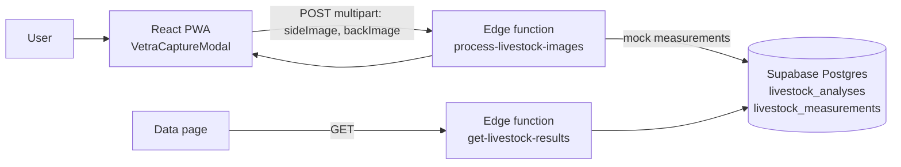

# VETRA Pashu Scan (UI prototype)

**Mobile-first PWA mock-up for VETRA, an AI cattle/buffalo trait-extraction tool: capture side and back photos, "analyse" them, and browse past results. Backend measurements are mocked.**


> **Prototype / superseded.** This was the first UI for VETRA (September 2025), generated with the Lovable AI builder. The trait values it shows are **random mock numbers** produced by a Supabase edge function, not model output. The UI was later rebuilt against a real FastAPI backend in [VETRA-v2.2-with-app](https://github.com/rupeshbharambe24/VETRA-v2.2-with-app) and finally in [VETRA---App](https://github.com/rupeshbharambe24/VETRA---App).

## Contents

- [Overview](#overview)
- [Highlights](#highlights)
- [Architecture](#architecture)
- [Tech stack](#tech-stack)
- [Project structure](#project-structure)
- [Getting started](#getting-started)
- [VETRA project map](#vetra-project-map)
- [License](#license)

## Overview

For SIH 2025 the VETRA team needed a field-friendly front end in the style of the Bharat Pashudhan livestock app: a farmer or field worker photographs an animal from the side and from behind and receives body measurements. This repository is that early front end. It was used to agree on screens and data shape while the pose-estimation models were still being trained in the ML repositories.

## Highlights

- Installable PWA layout with bottom navigation: Home, VETRA analysis, Data, Helpline, About, Contact.
- Two-step capture modal (side view, back view) using the device camera (`capture="environment"`) or file upload.
- Supabase edge function `process-livestock-images` stores the images (base64) and 11 measurements (6 side, 5 back: body length, withers height, girth, rump angle, hip width ...) with per-trait confidence. **All values are randomised placeholders.**
- `get-livestock-results` edge function and Data page list past analyses with entry IDs (`LV-<year>-NNNNNN`).
- SQL migration defining `livestock_analyses` and `livestock_measurements` tables.

## Architecture



<details>
<summary>Database schema (from <code>supabase/migrations/</code>)</summary>

| Table | Key columns |
|---|---|
| `livestock_analyses` | `id` (uuid), `entry_id` (`LV-YYYY-NNNNNN`), `side_image_url`, `back_image_url`, `analysis_status`, timestamps |
| `livestock_measurements` | `analysis_id` → analyses, `measurement_type` (`side`/`back`), `trait_name`, `value`, `unit`, `confidence` |

Row-level security is enabled but the demo policies allow all operations for anonymous users. Tighten them before reusing this schema.

</details>

## Tech stack

| Layer | Technology |
|---|---|
| Frontend | React 18, TypeScript, Vite 5, React Router 6, TanStack Query |
| UI | Tailwind CSS, shadcn/ui (Radix), lucide-react |
| Backend | Supabase (Postgres + Deno edge functions) |
| Tooling | Lovable (initial generation), ESLint |

## Project structure

```text
vetra-pashu-scan/
├── src/
│   ├── pages/            # Index/Home, VetraPage, DataPage, InfoPages (helpline, about, contact)
│   ├── components/       # VetraCaptureModal, CameraInterface, ResultsCard, BottomNavigation, ...
│   │   └── ui/           # shadcn/ui primitives
│   ├── integrations/supabase/   # client + generated DB types
│   ├── hooks/, lib/
│   └── main.tsx, App.tsx, index.css
├── supabase/
│   ├── config.toml
│   ├── functions/
│   │   ├── process-livestock-images/   # mock trait extraction + insert
│   │   └── get-livestock-results/      # list analyses with measurements
│   └── migrations/                     # table definitions
├── public/               # favicon, PWA manifest
├── .env.example
├── package.json, vite.config.ts, tailwind.config.ts
└── LICENSE
```

## Getting started

**Prerequisites:** Node.js 18+ and npm; a Supabase project plus the [Supabase CLI](https://supabase.com/docs/guides/cli) if you want the edge functions.

```bash
git clone https://github.com/rupeshbharambe24/vetra-pashu-scan.git
cd vetra-pashu-scan
npm install
cp .env.example .env      # fill in your Supabase URL, project ref and anon key
npm run dev               # http://localhost:8080
```

<details>
<summary>Deploy the Supabase side</summary>

```bash
supabase link --project-ref <your-project-ref>
supabase db push                                     # applies supabase/migrations
supabase functions deploy process-livestock-images --no-verify-jwt
supabase functions deploy get-livestock-results --no-verify-jwt
```

`supabase/config.toml` still contains the original project ref; change it to your own. Edge functions read `SUPABASE_URL` and `SUPABASE_SERVICE_ROLE_KEY` from the Supabase runtime environment.

</details>

Notes: the PWA manifest references icons (`icon-192.png`, `icon-512.png`) that were never added, and the Helpline and Contact pages contain placeholder contact details.

## VETRA project map

VETRA (SIH 2025, Grand Finale Top 5) is split across several repositories. ML work evolved v1.1 → v2.0 → v2.2 → v3.0; the apps below consume or capture data for those models.

| Repository | What it is | Stack | Status |
|---|---|---|---|
| [VETRA-v1.1](https://github.com/rupeshbharambe24/VETRA-v1.1) | First ML experiment: 6-keypoint YOLOv8n-pose on side-view cow images + regressors mapping keypoint distances to body measurements (cm) | Python, YOLOv8-pose, scikit-learn | Archived (ML) |
| [VETRA-v2.0](https://github.com/rupeshbharambe24/VETRA-v2.0) | Separate side (10 kp) and back (8 kp) YOLOv8n-pose models, per-measurement pixel-to-cm scaling, measurement extraction, prototype type/breed scoring | Python, Ultralytics | Archived (ML) |
| [VETRA-v2.2-with-app](https://github.com/rupeshbharambe24/VETRA-v2.2-with-app) | v2 pipeline retrained and wrapped in a first FastAPI backend + React UI (`/api/v1/process-image`) | Python, FastAPI, React | Archived (ML + app) |
| [VETRA-v3.0](https://github.com/rupeshbharambe24/VETRA-v3.0) | Final training: side (14 kp), back (10 kp) and udder-bottom (8 kp) YOLOv8n-pose models, udder U-Net + ResNet18, ArUco scaling, dataset tooling | Python, Ultralytics, PyTorch | Final models |
| [VETRA---App](https://github.com/rupeshbharambe24/VETRA---App) | Final system: FastAPI backend serving the v3.0 pose models + udder U-Net (ResNet34 encoder) and ResNet18 classifier, NDDB-style trait scoring, React web UI | FastAPI, PyTorch, React + Vite | Final (SIH 2025 finale) |
| [vetra-main-app-latest-v3](https://github.com/rupeshbharambe24/vetra-main-app-latest-v3) | Flutter field app: capture protocol, offline SQLite records, PDF reports (not yet wired to the analysis API) | Flutter, Riverpod, SQLite | Prototype |
| [vetra-depth-recorder-latest-v3](https://github.com/rupeshbharambe24/vetra-depth-recorder-latest-v3) | RGB + ARCore depth capture with intrinsics, pose and ZIP export | Flutter, Kotlin, ARCore | Prototype |
| [VETRA---Depth-Recorder](https://github.com/rupeshbharambe24/VETRA---Depth-Recorder) | Earlier capture app: RGB frames + phone-sensor pose metadata (no real depth) | Expo / React Native, TypeScript | Superseded |
| **[vetra-pashu-scan](https://github.com/rupeshbharambe24/vetra-pashu-scan)** (this repo) | Early Lovable-generated PWA UI; Supabase edge functions return mock measurements | Vite, React, Supabase | Superseded (UI prototype) |
| [pashudhan-ui](https://github.com/rupeshbharambe24/pashudhan-ui) | Fork of a teammate's Lovable UI prototype (landing page + mock prediction page) | Vite, React | Fork |

## License

[MIT](LICENSE) © 2025 Rupesh Bharambe
